> **Implementation status** (baseline migration `1749000000000-BaselineV6`)
>
> - **All tables below exist as drawn.**
> - **Extra table, not in v6:** `user_session` (refresh-token sessions for auth).
> - **Extra columns, not in v6** (see `Docs/decisions/0001-supervisor-dashboard.md`):
>   - `client_request_id` on ORDER, PAYMENT, GATE_PASS and STOCK_TRANSFER, so a create is safe to retry.
>   - `order_id` on MATERIAL_ALLOCATION, because customer material is reserved per order.
>   - `reject_reason`, `receive_notes`, `closed_by` and `closed_at` on STOCK_TRANSFER.
> - **Stock reservation** (migration `1761200000000-StockReservation`, see `Docs/decisions/0003-stock-reservation.md`):
>   - `reserved_quantity` on BRANCH_STOCK (held for open orders; available = quantity − reserved_quantity).
>   - Extra table `stock_reservation` (branch_id, item_id, order_id, line_id, quantity, shortfall, status RESERVED|CONSUMED|RELEASED, override_reason, release_reason, created_by, created_at, closed_at).
> - **Not used yet:** STOCK_TRANSFER status `APPROVED` and `approved_by` / `approved_at` (stock requests have no approval step).
> - **Global scope** (migration `1761100000000-GlobalScopeMainBranch`, see `Docs/decisions/0002-global-scope-and-main-branch.md`):
>   - `branch.is_main` marks the one main (distribution) branch, Naiwala.
>   - USER_ROLE: SUPER_ADMIN, ADMIN and AUDITOR have no branch; every other role, MANAGER included, has exactly one.

```mermaid
erDiagram
 
  %% ══════════════ ORGANISATION & ACCESS ══════════════
 
  BRANCH {
    uuid branch_id PK
    string code UK
    string name
    enum branch_type "ROOFING|WORKSHOP|ROOFING_WORKSHOP"
    string phone
    string location
    jsonb settings "Zod-validated: sections, min_advance_pct_customized, min_advance_pct_standard, stock_override_enabled, pick-lists, number prefixes"
    string stock_override_password_hash
    boolean is_main "one main (distribution) branch — partial UK"
    boolean is_active
    uuid updated_by FK
    timestamp updated_at
  }
 
  BRANCH_TYPE_DEFAULT {
    enum branch_type PK
    jsonb settings
    uuid updated_by FK
    timestamp updated_at
  }
 
  EMPLOYEE {
    uuid employee_id PK
    uuid branch_id FK
    string employee_code UK
    string full_name
    string designation
    string phone
    jsonb salary "basic, travelling, target, performance, leave"
    boolean is_active
    uuid created_by FK
    timestamp created_at
  }
 
  USER {
    uuid user_id PK
    uuid employee_id FK "nullable, UK — global admins may not be employees"
    uuid branch_id FK "home branch; null = global user"
    string full_name
    string username UK
    string email "nullable, UK when present"
    string phone
    string password_hash
    boolean must_change_password "true on create and on admin reset"
    timestamp password_changed_at
    timestamp temp_password_expires_at "nullable — temp password stops working after e.g. 72h"
    integer failed_login_count
    timestamp locked_until "nullable — lockout after N failed attempts"
    boolean is_active
    uuid created_by FK
    timestamp created_at
    timestamp last_login_at
  }
 
  USER_ROLE {
    uuid user_role_id PK
    uuid user_id FK
    uuid branch_id FK "null exactly for global roles (SUPER_ADMIN, ADMIN, AUDITOR)"
    enum role "SUPER_ADMIN|ADMIN|AUDITOR|MANAGER|SUPERVISOR|CHIEF|CASHIER"
    boolean is_active
    uuid assigned_by FK
    timestamp assigned_at
  }
 
  PERMISSION {
    uuid permission_id PK
    string module
    string action
    string description
    boolean is_system
  }
 
  ROLE_PERMISSION {
    enum role PK
    uuid permission_id PK, FK
    boolean granted
    uuid set_by FK
    timestamp set_at
  }
 
  CUSTOMER {
    uuid customer_id PK
    uuid home_branch_id FK
    enum customer_type "INDIVIDUAL|BUSINESS"
    string phone UK
    string name
    string company_name "required when BUSINESS"
    string contact_person
    string email
    string address
    uuid created_by FK "supervisor"
    uuid completed_by FK "cashier"
    timestamp created_at
    timestamp completed_at "null = profile incomplete"
  }
 
  %% ══════════════ ORDERS ══════════════
 
  ORDER {
    uuid order_id PK
    uuid branch_id FK
    uuid origin_branch_id FK "nullable; HARDWARE_SALE placed by another branch's cashier (Docs/decisions/0006)"
    uuid customer_id FK "nullable only when order_type = HARDWARE_SALE"
    enum order_type "JOB_CARD|ROOFING_ORDER|HARDWARE_SALE"
    enum section_type "WORKSHOP|HARDWARE|ROOFING"
    enum service_type "FABRICATION|BUY_MATERIALS"
    string order_number UK
    enum status "DRAFT|IN_QUEUE|IN_PROGRESS|CANCELLATION_PENDING|CLOSED|VOIDED"
    integer subtotal "cents"
    integer discount "cents"
    integer total "cents"
    integer paid_amount "cached, recomputed from ledger; balance = total - paid_amount"
    enum delivery_method "PICKUP|DELIVERY"
    string released_to
    uuid released_by FK
    timestamp released_at
    text release_notes
    jsonb header "roofing: department, b_no, issued_to, approved_by"
    boolean is_legacy
    uuid created_by FK
    enum actor_role_at_creation
    timestamp created_at
    timestamp updated_at
    integer version "optimistic lock"
  }
 
  ORDER_LINE {
    uuid line_id PK
    uuid order_id FK
    string line_number UK "WO-#####"
    integer line_no
    enum line_type "CUT_BEND|ROLLING|COIL_CUTTING|ROOFING_SHEET|ROOFING_ACCESSORY|HARDWARE|MATERIAL"
    enum sub_type "CUT|BEND|PIPE_BEND|BOX_BAR_BEND|FLAT_IRON|L_ANGLE|SHEET_ROLL|COIL_CUT, null for non-workshop"
    enum status "PENDING|ASSIGNED|IN_PROGRESS|COMPLETED|CANCELLED"
    enum material_source "BRANCH|CUSTOMER"
    uuid item_id FK "nullable"
    jsonb spec "model-specific only: thickness_mm, gauge_size, length_m, sheet_cuts, sheet_pieces, work_type, size"
    decimal quantity "count of cuts / bends / pieces / ft"
    decimal weight_kg "scalar, COIL_CUTTING"
    string color
    enum price_basis "PER_CUT|PER_BEND|PER_PIECE|PER_FT|PER_KG|PER_CUT_PER_M|FIXED"
    integer unit_price "cents, snapshot"
    integer line_total "cents"
    integer suggested_advance "cents"
    boolean is_customized
    string customized_reason_code
    text work_info
    text notes
    uuid created_by FK
    enum actor_role_at_creation
    timestamp created_at
    timestamp completed_at
    integer version "optimistic lock"
  }
 
  LINE_ASSIGNMENT {
    uuid line_id PK, FK
    uuid employee_id PK, FK
    uuid assigned_by FK
    timestamp assigned_at
  }
 
  STATUS_HISTORY {
    uuid history_id PK
    uuid order_id FK
    uuid line_id FK "nullable"
    enum event_type "STATUS_CHANGE|NOTE|INSPECTION"
    string from_status
    string to_status
    enum result "PASS|FAIL, inspection only"
    text note
    uuid actor_id FK
    enum actor_role
    timestamp created_at
  }
 
  PRICE_RATE {
    uuid rate_id PK
    uuid branch_id FK "null = master template"
    enum line_type
    enum sub_type "nullable"
    string variant "material type / category / accessory"
    string work_type "rolling work_type, nullable"
    string thickness_or_size "nullable"
    enum material_source "BRANCH|CUSTOMER"
    enum price_basis
    integer rate "cents"
    boolean is_active
    uuid created_by FK
    timestamp created_at
    timestamp updated_at
  }
 
  %% ══════════════ MONEY ══════════════
 
  PAYMENT {
    uuid payment_id PK
    uuid order_id FK
    enum kind "ADVANCE|PARTIAL|FINAL|REVERSAL"
    enum mode "CASH|CARD|TRANSFER"
    enum status "COMPLETED|REVERSED"
    integer amount "cents"
    string reference_number
    string receipt_no UK
    uuid reverses_payment_id FK "nullable"
    uuid received_by FK "cashier"
    uuid received_branch_id FK "branch where the money was taken (Docs/decisions/0006)"
    timestamp paid_at
  }
 
  INVOICE {
    uuid invoice_id PK
    uuid order_id FK
    string invoice_number UK
    enum invoice_type "ADVANCE|FINAL|TAX"
    integer subtotal
    integer tax_rate
    integer tax_amount
    integer total_amount
    string pdf_url
    uuid issued_by FK
    timestamp issued_at
  }
 
  FINANCIAL_ACCOUNT {
    uuid account_id PK
    string code UK
    string name
    enum account_type "ASSET|LIABILITY|REVENUE|EXPENSE"
    enum normal_balance "DEBIT|CREDIT"
    boolean is_system
    boolean is_active
  }
 
  LEDGER_ENTRY {
    uuid entry_id PK
    uuid branch_id FK
    uuid account_id FK
    enum entry_type "DEBIT|CREDIT"
    integer amount "cents, always positive"
    string source_type "PAYMENT|CANCELLATION|STOCK_DEDUCTION|PETTY_CASH|PAYSLIP|LEGACY_OPENING"
    uuid source_id
    uuid order_id FK "nullable"
    text description
    uuid reverses_entry_id FK "nullable"
    uuid created_by FK
    enum actor_role
    timestamp created_at
  }
 
  PETTY_CASH {
    uuid petty_cash_id PK
    uuid branch_id FK
    uuid requested_by FK "cashier"
    uuid requested_for FK "employee, nullable"
    enum category
    integer amount
    integer spent
    text description
    string reference_note
    enum status "PENDING|APPROVED|RELEASED|SETTLED|REJECTED|CANCELLED"
    timestamp created_at
  }
 
  APPROVAL_REQUEST {
    uuid approval_id PK
    uuid branch_id FK
    enum request_type "PETTY_CASH|DISCOUNT_OVERRIDE|ORDER_CANCELLATION|LINE_CANCELLATION|STOCK_TRANSFER"
    string entity_type
    uuid entity_id
    integer amount
    string reason_code
    text reason_detail
    string prior_status "cancellation: restored on reject"
    boolean materials_consumed "cancellation only (BR15)"
    uuid attested_by FK "cancellation only"
    timestamp attested_at
    enum status "PENDING|APPROVED|REJECTED"
    uuid requested_by FK
    uuid decided_by FK
    text decision_note
    timestamp created_at
    timestamp decided_at
  }
 
  PAYROLL_RUN {
    uuid run_id PK
    uuid branch_id FK
    integer year
    integer month
    enum status "DRAFT|COMPLETED"
    uuid created_by FK
    timestamp created_at
  }
 
  PAYSLIP {
    uuid payslip_id PK
    uuid run_id FK
    uuid employee_id FK
    jsonb earnings
    jsonb deductions
    jsonb inputs
    integer gross
    integer total_deductions
    integer net
  }
 
  %% ══════════════ CUSTOMER MATERIAL ══════════════
 
  GATE_PASS {
    uuid gate_pass_id PK
    uuid branch_id FK
    uuid customer_id FK
    string pass_number UK
    enum status "OPEN|CLOSED"
    text notes
    uuid issued_by FK
    timestamp created_at
    timestamp closed_at
  }
 
  GATE_PASS_ITEM {
    uuid gp_item_id PK
    uuid gate_pass_id FK
    string material_type
    string thickness
    decimal length
    enum length_unit "FT|INCHES"
    string color
    integer quantity
    string condition_note
  }
 
  MATERIAL_ALLOCATION {
    uuid allocation_id PK
    uuid gp_item_id FK
    uuid line_id FK "null while draft"
    string draft_id
    integer quantity
    enum status "RESERVED|COMMITTED|RELEASED"
    string release_reason
    uuid accepted_by FK
    timestamp expires_at
    timestamp created_at
  }
 
  %% ══════════════ INVENTORY ══════════════
 
  ITEM {
    uuid item_id PK
    string sku UK
    string name
    enum item_type "HARDWARE|COIL|MATERIAL"
    string category
    string unit
    jsonb attributes "coil: origin, thickness, color"
    integer unit_cost
    integer price
    boolean is_active
  }
 
  BRANCH_STOCK {
    uuid branch_id PK, FK
    uuid item_id PK, FK
    decimal quantity "CHECK >= 0"
    decimal reorder_level
  }
 
  STOCK_MOVEMENT {
    uuid movement_id PK
    uuid branch_id FK
    uuid item_id FK
    enum movement_type "SALE|JOB_USAGE|JOB_REVERSAL|TRANSFER_OUT|TRANSFER_IN|TRANSFER_RETURN|ADJUSTMENT|OVERRIDE|LEGACY_OPENING"
    decimal quantity "+ in / - out"
    decimal quantity_after
    uuid line_id FK "nullable"
    uuid transfer_line_id FK "nullable"
    text reason
    uuid created_by FK
    timestamp moved_at
  }
 
  STOCK_ALERT {
    uuid alert_id PK
    uuid branch_id FK
    uuid item_id FK
    decimal quantity_at_alert
    enum status "OPEN|ACKNOWLEDGED|RESOLVED"
    uuid acknowledged_by FK
    timestamp created_at
    timestamp acknowledged_at
  }
 
  STOCK_TRANSFER {
    uuid transfer_id PK
    string transfer_number UK
    uuid requesting_branch_id FK
    uuid supplying_branch_id FK
    string source_document_number "Main Warehouse goods issue no. (BR13)"
    enum status "PENDING|APPROVED|ISSUED|CONFIRMED|REJECTED|CANCELLED"
    date needed_before
    boolean is_urgent
    text notes
    uuid requested_by FK
    uuid approved_by FK "supplying branch ADMIN (BR12)"
    uuid sent_by FK
    uuid received_by FK
    timestamp created_at
    timestamp approved_at
    timestamp sent_at
    timestamp received_at
  }
 
  STOCK_TRANSFER_LINE {
    uuid transfer_line_id PK
    uuid transfer_id FK
    uuid item_id FK
    decimal qty_requested
    decimal qty_sent
    decimal qty_received
    string reference_number
    text notes
  }
 
  %% ══════════════ CROSS-CUTTING ══════════════
 
  ATTACHMENT {
    uuid attachment_id PK
    string entity_type "ORDER_LINE|PETTY_CASH|APPROVAL_REQUEST|..."
    uuid entity_id
    string purpose "DESIGN_PHOTO|COMPLETION_PHOTO|BILL|..."
    string file_name
    string file_type
    string file_url
    uuid uploaded_by FK
    timestamp uploaded_at
  }
 
  NOTIFICATION {
    uuid notification_id PK
    uuid order_id FK
    uuid customer_id FK
    enum channel "SMS|WHATSAPP|EMAIL"
    string template_id
    string recipient_contact
    text message
    enum status "QUEUED|SENT|FAILED"
    integer retry_count
    text failure_reason
    uuid sent_by FK
    timestamp sent_at
  }
 
  SYNC_CONFLICT {
    uuid conflict_id PK
    uuid branch_id FK
    string entity_type
    uuid entity_id
    jsonb client_snapshot
    jsonb server_snapshot
    enum status "PENDING|RESOLVED|DISMISSED"
    uuid reported_by FK
    uuid resolved_by FK
    text resolution_note
    timestamp created_at
    timestamp resolved_at
  }
 
  LEGACY_IMPORT {
    uuid import_id PK
    uuid order_id FK "UK"
    string legacy_reference UK
    jsonb raw_import_data
    uuid imported_by FK
    timestamp imported_at
  }
 
  AUDIT_LOG {
    uuid audit_id PK
    uuid user_id FK
    uuid branch_id FK
    enum actor_role
    string entity_type
    uuid entity_id
    integer entity_version
    string action
    jsonb old_value
    jsonb new_value
    string ip_address
    timestamp logged_at
  }
 
  %% ── Organisation & access ───────────────────────────
  BRANCH ||--o{ EMPLOYEE : "staffs"
  EMPLOYEE |o--o| USER : "logs in as"
  BRANCH |o--o{ USER : "home of"
  USER |o--o{ USER : "creates"
  USER ||--o{ USER_ROLE : "has"
  BRANCH |o--o{ USER_ROLE : "scopes"
  PERMISSION ||--o{ ROLE_PERMISSION : "granted via"
  USER ||--o{ ROLE_PERMISSION : "sets"
  BRANCH |o--o{ CUSTOMER : "home of"
  USER ||--o{ BRANCH_TYPE_DEFAULT : "updates"
 
  %% ── Orders ──────────────────────────────────────────
  BRANCH ||--o{ ORDER : "takes"
  CUSTOMER |o--o{ ORDER : "places"
  USER ||--o{ ORDER : "creates"
  ORDER ||--o{ ORDER_LINE : "contains"
  ORDER_LINE ||--o{ LINE_ASSIGNMENT : "worked by"
  EMPLOYEE ||--o{ LINE_ASSIGNMENT : "assigned"
  USER ||--o{ LINE_ASSIGNMENT : "assigns"
  ORDER ||--o{ STATUS_HISTORY : "history"
  ORDER_LINE |o--o{ STATUS_HISTORY : "line history"
  USER ||--o{ STATUS_HISTORY : "acts"
  ITEM |o--o{ ORDER_LINE : "used in"
  BRANCH |o--o{ PRICE_RATE : "prices"
  ORDER |o--o| LEGACY_IMPORT : "imported as"
 
  %% ── Money ───────────────────────────────────────────
  ORDER ||--o{ PAYMENT : "paid by"
  PAYMENT |o--o| PAYMENT : "reverses"
  USER ||--o{ PAYMENT : "receives"
  ORDER ||--o{ INVOICE : "billed by"
  FINANCIAL_ACCOUNT ||--o{ LEDGER_ENTRY : "categorises"
  BRANCH ||--o{ LEDGER_ENTRY : "records"
  ORDER |o--o{ LEDGER_ENTRY : "tracked in"
  LEDGER_ENTRY |o--o| LEDGER_ENTRY : "reverses"
  BRANCH ||--o{ PETTY_CASH : "spends"
  EMPLOYEE |o--o{ PETTY_CASH : "requested for"
  BRANCH ||--o{ APPROVAL_REQUEST : "raises"
  USER ||--o{ APPROVAL_REQUEST : "requests / decides"
  BRANCH ||--o{ PAYROLL_RUN : "runs"
  PAYROLL_RUN ||--|{ PAYSLIP : "contains"
  EMPLOYEE ||--o{ PAYSLIP : "paid via"
 
  %% ── Customer material ──────────────────────────────
  BRANCH ||--o{ GATE_PASS : "receives"
  CUSTOMER ||--o{ GATE_PASS : "brings"
  GATE_PASS ||--|{ GATE_PASS_ITEM : "lists"
  GATE_PASS_ITEM ||--o{ MATERIAL_ALLOCATION : "allocated via"
  ORDER_LINE |o--o{ MATERIAL_ALLOCATION : "consumes"
 
  %% ── Inventory ───────────────────────────────────────
  ITEM ||--o{ BRANCH_STOCK : "stocked as"
  BRANCH ||--o{ BRANCH_STOCK : "holds"
  ITEM ||--o{ STOCK_MOVEMENT : "moves"
  BRANCH ||--o{ STOCK_MOVEMENT : "records"
  ORDER_LINE |o--o{ STOCK_MOVEMENT : "deducts"
  STOCK_TRANSFER_LINE |o--o{ STOCK_MOVEMENT : "moves"
  ITEM ||--o{ STOCK_ALERT : "triggers"
  BRANCH ||--o{ STOCK_ALERT : "receives"
  BRANCH ||--o{ STOCK_TRANSFER : "requests"
  BRANCH ||--o{ STOCK_TRANSFER : "supplies"
  STOCK_TRANSFER ||--|{ STOCK_TRANSFER_LINE : "contains"
  ITEM ||--o{ STOCK_TRANSFER_LINE : "transferred"
 
  %% ── Cross-cutting ───────────────────────────────────
  ORDER ||--o{ NOTIFICATION : "triggers"
  CUSTOMER ||--o{ NOTIFICATION : "receives"
  BRANCH ||--o{ SYNC_CONFLICT : "has"
  USER ||--o{ SYNC_CONFLICT : "reports / resolves"
  USER ||--o{ AUDIT_LOG : "acts"
  USER ||--o{ ATTACHMENT : "uploads"
```

